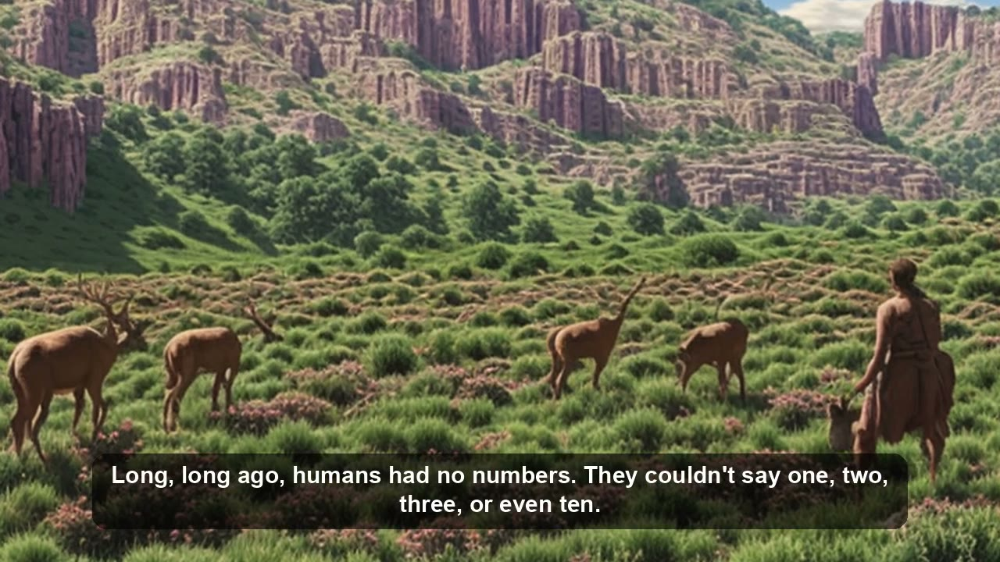
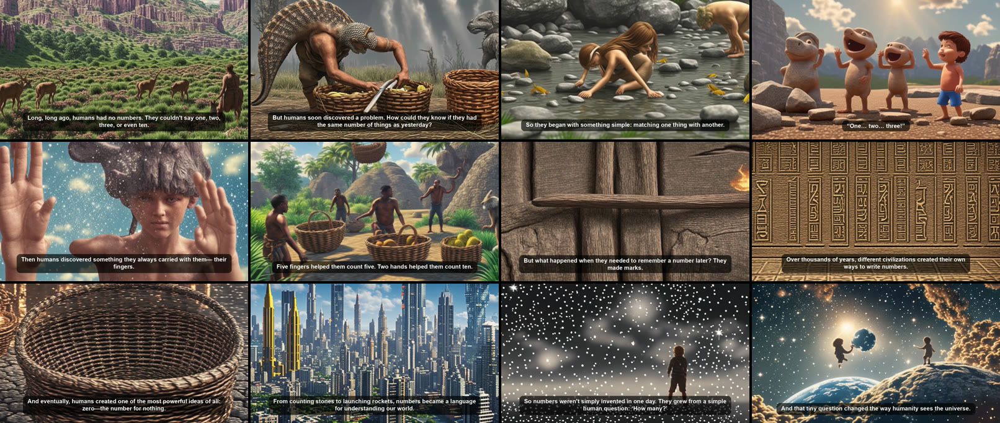

# Local Script → Video Generator (M1 / 8GB)

Paste a script and get a narrated, captioned, animated explainer video. It runs locally on an Apple Silicon Mac (tested on an M1 MacBook Air with 8GB RAM) with no API keys or fees.

```
script ─► scenes ─┬─► neural voiceover (Kokoro TTS)      ─┐
                  └─► AI image per scene (SD-Turbo · MPS) ─┴─► ffmpeg: Ken Burns motion + captions ─► final_video.mp4
```

## Example output: *How Humans Discovered Numbers*

[](examples/how-humans-discovered-numbers/how_humans_discovered_numbers.mp4)

▶️ **[Watch the video (MP4, 76 s, 1280×720)](examples/how-humans-discovered-numbers/how_humans_discovered_numbers.mp4)**



| | |
|---|---|
| **Input** | [`samples/how_humans_discovered_numbers.md`](samples/how_humans_discovered_numbers.md): an 11-scene screenplay with `Narrator:`, `Child:` and `Visual Prompt:` lines |
| **Scenes** | 12 video shots (Scene 11 has two narration beats) · [scene plan](examples/how-humans-discovered-numbers/scene_plan.txt) |
| **Voice** | Kokoro · British male "George" (narrator), speed 0.92. The `Child:` line uses a separate voice, pitched up automatically |
| **Images** | Local SD-Turbo on the M1 GPU (MPS), 768×448, 2 steps, art style "3D animated film" |
| **Video** | 16:9 1280×720, 25 fps, Ken Burns zoom 0.15, burned-in captions · 76 s · 9.5 MB |
| **Render time** | ~31 min on an 8GB M1 MacBook Air while Chrome and Firefox were open (heavy swap). Most of that time went to image generation |

**What worked:** the narrator's pacing and accent, the child character voice, and the caption and scene timing. Scenic shots came out well: the valley, the city skyline, the starry sky.
**Limits of SD-Turbo:** complex shots with people get garbled (in Scene 2 the fish turned into a strange tail), and it can't draw readable digits, tally marks or a "0". For better images, use the **Cloud · Pollinations** engine (FLUX), or SDXL-Turbo on a Mac with more RAM.

## Run

```bash
./run.sh
```

Then open http://127.0.0.1:7860. On the first run, `run.sh` installs `ffmpeg` and `espeak-ng` with Homebrew if they're missing, creates `.venv` (Python 3.12) and installs `requirements.txt`. Model weights download on first use: SD-Turbo is ~2.5GB and Kokoro ~330MB, both cached in `~/.cache/huggingface`.

## Using it

1. Paste your script, in screenplay format or as plain paragraphs (see below). The example script loads by default.
2. Optional: click **Plan scenes** to review and edit each scene's narration and image prompt.
3. Choose the image engine, art style, format (16:9, 9:16 or 1:1), voice engine, narrator and character voices, and speed. Click **🔊 Preview voices** to hear the first scene before rendering.
4. Click **Generate video**.

Each run is saved in `outputs/<timestamp>/`. The folder holds `final_video.mp4`, the image, voice WAV and clip for each scene, and `script.txt` (the scene plan).

## Script formats

**Screenplay style** (like the example):

```
**Scene 4 — One, Two, Three**
**Visual:** A child collects three stones...
**Child:** “One… two… three!”
**Visual Prompt:** Young prehistoric child excitedly pointing at three stones...
```

- Each `Visual Prompt:` closes the lines spoken before it into one video shot, so a scene with two Narrator/Visual Prompt pairs becomes two shots.
- `Narrator:` lines use the narrator voice. Any other speaker (`Child:`, `Hunter:` …) uses the character voice, and child speakers are pitched up.
- `Visual:` is used only when a block has no `Visual Prompt:`. Titles, `---` dividers and markdown `**` are ignored.

**Plain paragraphs:** blank lines separate paragraphs, and long paragraphs are split every N sentences (the "Sentences per scene" slider). Add `[visual: ...]` under a paragraph to choose its image. Otherwise, the prompt is built from the narration.

## Voice engines

| Engine | Quality | Notes |
|---|---|---|
| **Kokoro** (default) | natural neural voice | Local, ~5 s per scene on CPU. 13 US and UK voices |
| **Edge** | very natural | Free Microsoft neural voices (Ryan, Sonia, Andrew…). Your narration text is sent to Microsoft |
| **macOS say** | robotic | Instant, offline fallback |

For an academic, story-driven narrator, use **Kokoro · British male George** or **British female Emma** at speed ~0.9, or **Edge · British male Ryan**.

## Image engines

| Engine | Speed on M1 8GB | Notes |
|---|---|---|
| **Local · SD-Turbo** (default) | ~45 s–2.5 min/image with browsers open (heavy swap); faster with free RAM | ~2.5GB, 2-step generation, fits in 8GB |
| **Local · SDXL-Turbo** | slow, will swap | ~7GB, better detail. Close other apps first |
| **Cloud · Pollinations** | depends on network | Free hosted FLUX, no key. Much better with people and hands. Your prompts are sent to pollinations.ai |
| **Offline · Placeholder** | instant | Gradient title cards. Use it to check voice and timing |

## Tips

- **Close other browsers** before a local render. On 8GB RAM, swap is the biggest slowdown.
- **Consistent subject / setting** (for example "a prehistoric family in fur clothing") is added to every prompt to keep characters consistent.
- A fixed **Seed** makes a run reproducible. The seed used is printed in the log.
- Set the art style to **None (raw prompt)** if your visual prompts already describe the style.

## Project layout

```
app.py          Gradio UI and orchestration
pipeline.py     scene parsing, TTS engines, image engines, captions, ffmpeg rendering
run.sh          one-command launcher
samples/        example scripts
examples/       rendered example output (video, poster, contact sheet, scene plan)
outputs/        your renders (git-ignored)
```
